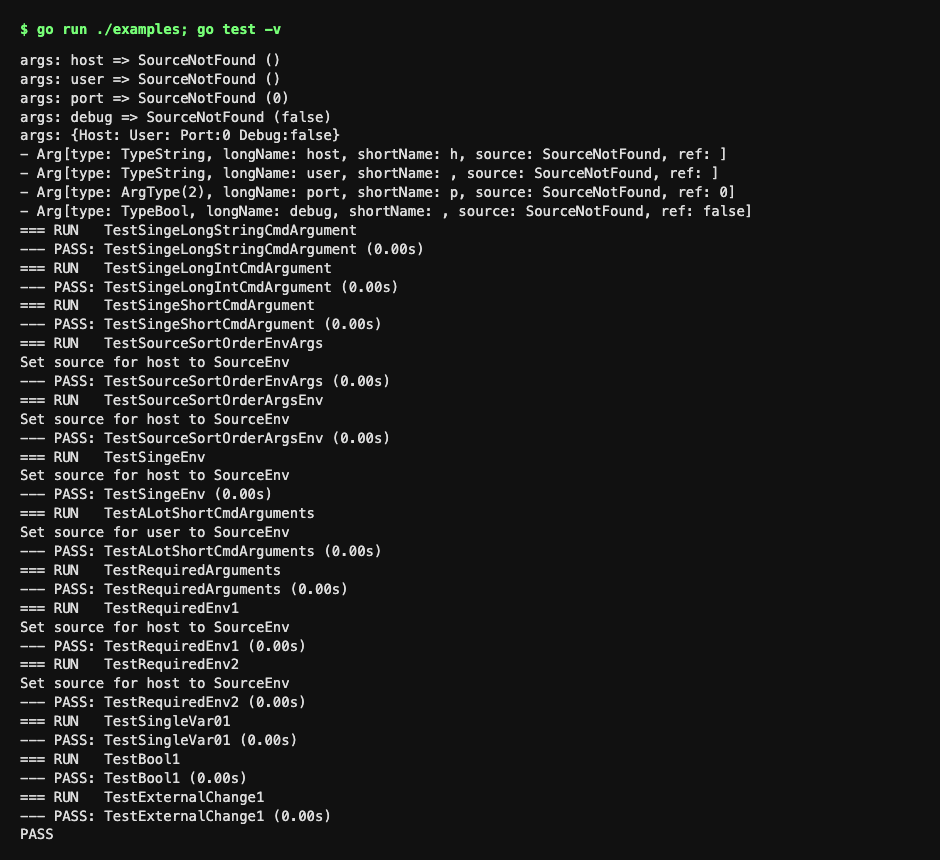
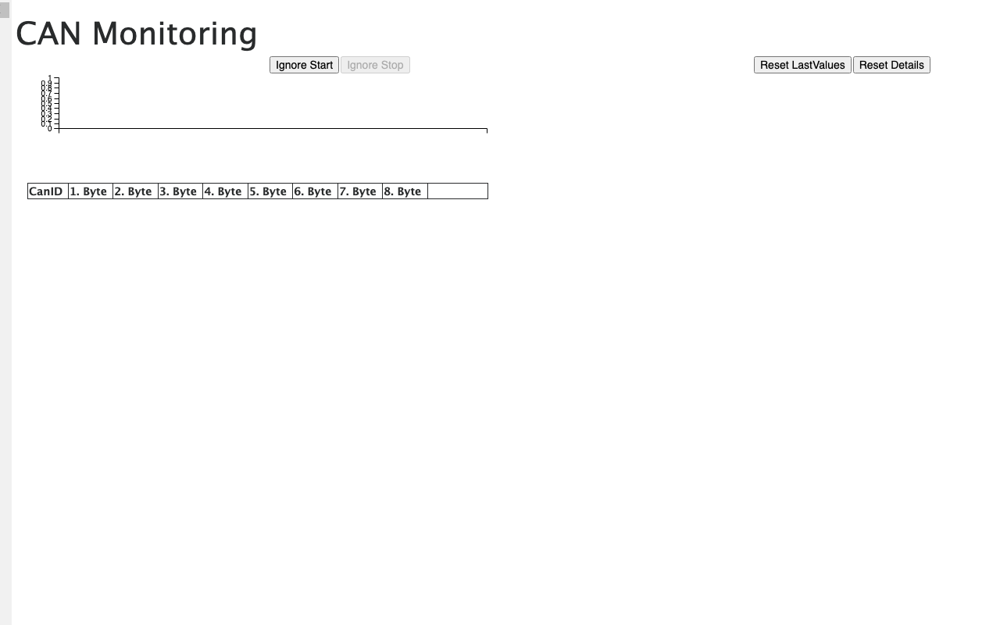

### Hi there 👋

  
  

## Screenshot gallery

Public projects; screenshots are shown where a real run could be captured.

<table>
<tr>
<td width="280" valign="top">
<a href="https://github.com/PKeidel/dbtolaravel"><b>dbtolaravel</b></a> &middot; Blade 
Reads a database and creates the migrations, models, controllers and blades for the tables
</td>
<td width="280" valign="top">
<a href="https://github.com/PKeidel/goargs"><b>goargs</b></a> &middot; Go 
Opinionated argument parser for go 
 
terminal output of the example (rendered as an image)
</td>
<td width="280" valign="top">
<a href="https://github.com/PKeidel/byteanalyzer"><b>byteanalyzer</b></a> &middot; Vue 
Analyze bytestreams like network packages captured by wireshark
</td>
</tr>
<tr>
<td width="280" valign="top">
<a href="https://github.com/PKeidel/fusemysql"><b>fusemysql</b></a> &middot; Go 
Mount a mysql database as a linux folder in your filesystem
</td>
<td width="280" valign="top">
<a href="https://github.com/PKeidel/banktolaravel"><b>banktolaravel</b></a> &middot; PHP 
HBCI/FinTS importer to local database with events on new entries
</td>
<td width="280" valign="top">
<a href="https://github.com/PKeidel/laradockctl"><b>laradockctl</b></a> &middot; PHP 
Manage your laradock via laravel artisan commands
</td>
</tr>
<tr>
<td width="280" valign="top">
<a href="https://github.com/PKeidel/nodejs-can-monitor"><b>nodejs-can-monitor</b></a> (archived) &middot; JavaScript 
nodejs Webpage with WebSocket server for analyzing CAN messages with an Arduino connected via Serial (USB) 
 
screenshot of the running web page
</td>
<td width="280" valign="top">
<a href="https://github.com/PKeidel/laralog"><b>laralog</b></a> (archived) &middot; PHP 
Request Logger For Laravel
</td>
<td width="280" valign="top">
<a href="https://github.com/PKeidel/php-server"><b>php-server</b></a> &middot; PHP 
Fun project to check what is possible with pure PHP
</td>
</tr>
</table>
